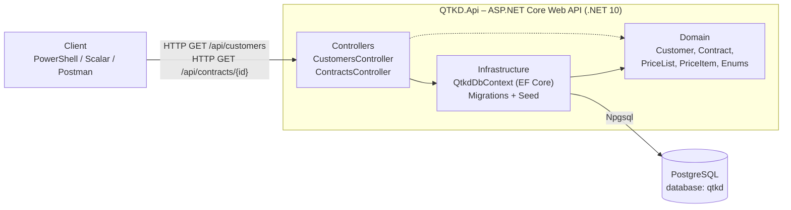
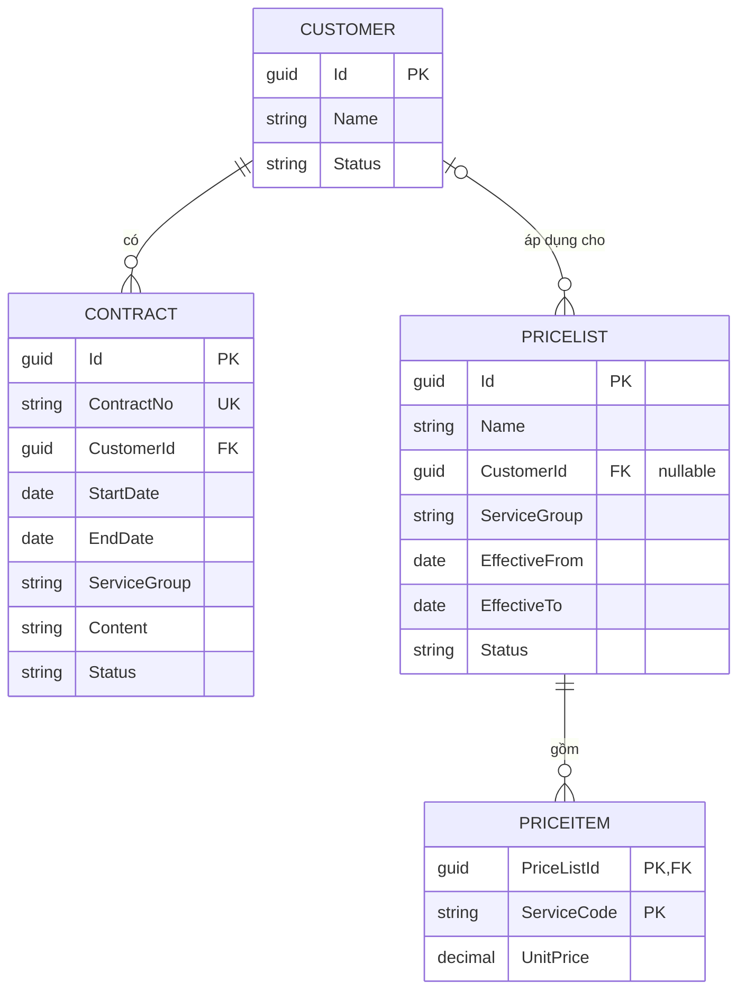
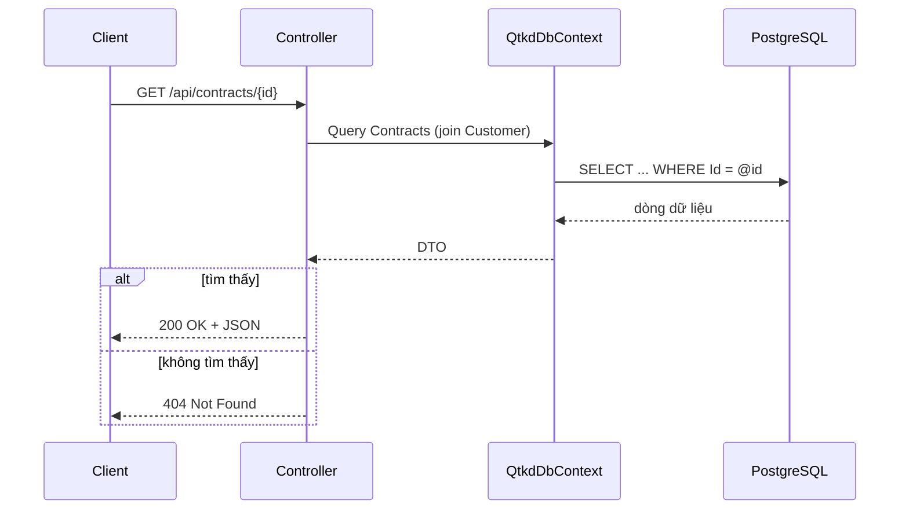

# Kiến trúc hệ thống QTKD (Phase 2 – Tuần 05)

Tài liệu mô tả các thành phần chính của solution tại cuối tuần 05: ứng dụng Web API kết nối PostgreSQL và đọc được dữ liệu Customer, Contract.

## 1. Sơ đồ thành phần



## 2. Vai trò từng thành phần

| Thành phần | Vị trí | Trách nhiệm |
|---|---|---|
| Client | Bên ngoài | Gọi API (PowerShell `Invoke-RestMethod`, Scalar, Postman). |
| Controllers | `src/QTKD.Api/Controllers` | Nhận HTTP request, trả response (DTO), xử lý 404. Tuần 06 sẽ thêm endpoint submit và gọi service nghiệp vụ. |
| Domain | `src/QTKD.Api/Domain` | Entity và enum trạng thái (`ContractStatus`, `PriceListStatus`, `CustomerStatus`). Không phụ thuộc vào EF hay HTTP. |
| Infrastructure | `src/QTKD.Api/Infrastructure` | `QtkdDbContext`: cấu hình quan hệ, ràng buộc, dữ liệu mẫu. Thư mục `Migrations/` chứa schema sinh bởi EF Core. |
| PostgreSQL | Máy cục bộ, port 5432 | Lưu dữ liệu thật. Chuỗi kết nối nằm trong User Secrets, không đưa lên Git. |

Lớp xử lý nghiệp vụ (service kiểm tra CTR-01, CTR-02, CTR-03) chưa có ở tuần 05. Tuần 06 sẽ thêm vào giữa Controllers và Infrastructure.

## 3. Mô hình dữ liệu



Ghi chú thiết kế:
- `Status` được lưu dạng chuỗi (ví dụ `Draft`) để đọc trực tiếp trong database dễ hơn.
- `PriceItem` dùng khóa chính ghép (`PriceListId`, `ServiceCode`) nên một bảng giá không có hai dòng trùng mã dịch vụ.
- `PriceList.CustomerId` cho phép null vì PRC-01 cũng cho gắn bảng giá với hợp đồng, nhóm dịch vụ hoặc phạm vi áp dụng khác.
- `Contract.Content` và `Contract.ServiceGroup` là cột bổ sung để tuần 06 kiểm tra CTR-02. Danh sách nội dung/tệp bắt buộc chính thức vẫn cần xác nhận.

## 4. Luồng đọc dữ liệu (tuần 05)



## 5. Cấu trúc thư mục

```
repo/
├─ QTKD.slnx
├─ README.md
├─ src/
│  └─ QTKD.Api/
│     ├─ Controllers/
│     ├─ Domain/
│     ├─ Infrastructure/
│     ├─ Migrations/
│     └─ Program.cs
├─ tests/        (tuần 07)
└─ docs/
   └─ architecture.md
```
